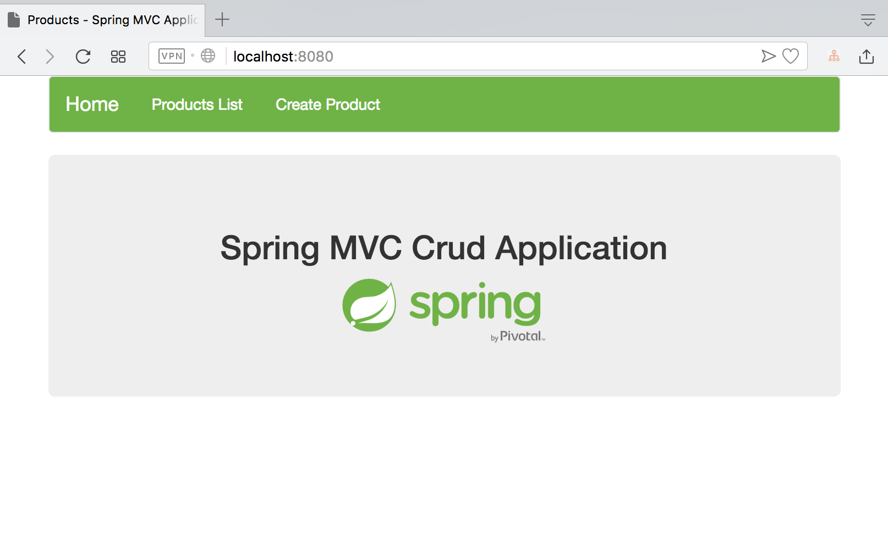
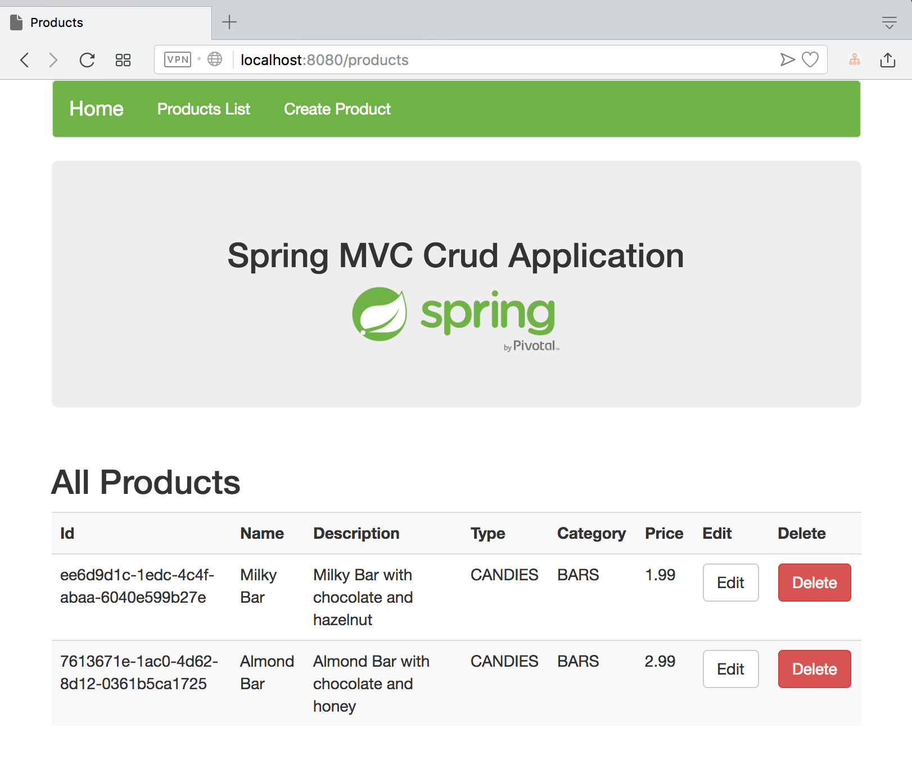
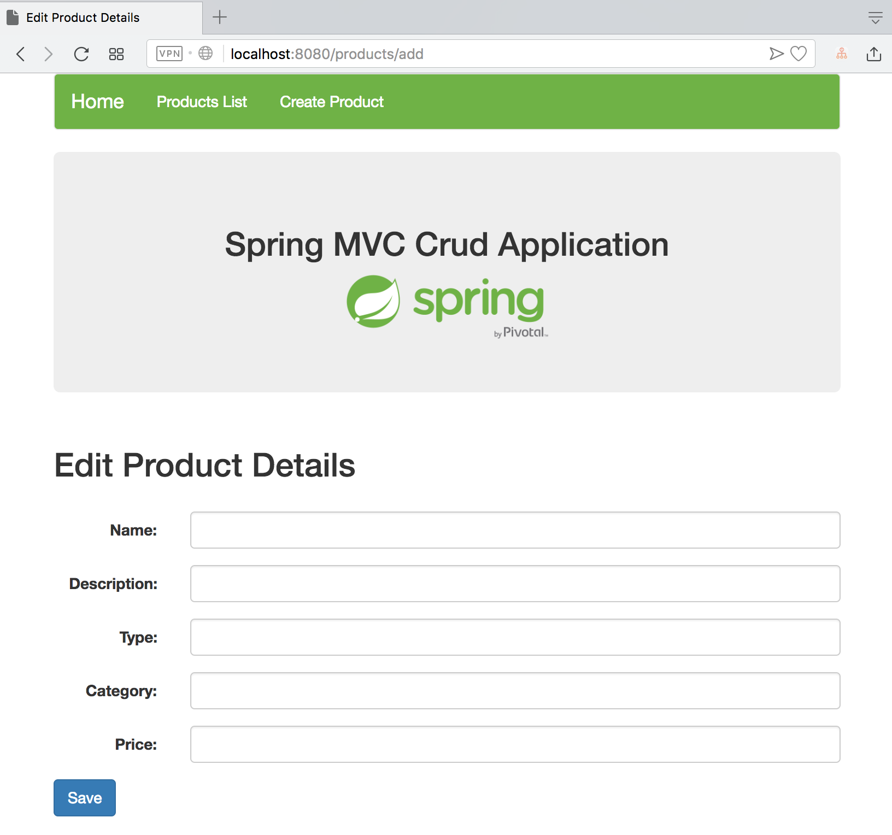

# Spring Boot Keycloak Thymeleaf CRUD

[](https://github.com/hendisantika/spring-boot-keycloak-thymeleaf-crud/actions/workflows/maven.yml)


A Spring MVC CRUD application built with Spring Boot, Spring Data JPA, Thymeleaf, HTML5, CSS3 and Bootstrap,
secured with **Keycloak** through **Spring Security OAuth2 Client (OpenID Connect)**.

## Tech Stack

| Component        | Version / Notes                                                         |
|------------------|-------------------------------------------------------------------------|
| Java             | 25 (Temurin)                                                            |
| Spring Boot      | 4.1.x                                                                   |
| Spring Security  | 7.x — `oauth2Login()` + method security (`@RolesAllowed`)               |
| Keycloak         | OIDC provider (realm `PowerRanger`, client `login-app`)                 |
| Persistence      | Spring Data JPA + H2 in-memory database                                 |
| View             | Thymeleaf + Bootstrap (WebJars)                                         |
| Build            | Maven Wrapper (Maven 3.10.x)                                            |

> The legacy Keycloak Spring adapter (`keycloak-spring-boot-starter`) is deprecated and does not work with
> Spring Boot 3+/4. This project uses Spring Security's native OAuth2/OIDC support instead.

## Prerequisites

- JDK 25
- Docker & Docker Compose (to run Keycloak)

## Run Keycloak

### Docker Compose (recommended)

Starts Keycloak + PostgreSQL and imports the `PowerRanger` realm from [`PowerRanger.json`](PowerRanger.json):

```shell
docker compose up -d
```

### Docker

```shell
docker run --name keycloak_dev \
  -p 8080:8080 \
  -e KC_BOOTSTRAP_ADMIN_USERNAME=admin \
  -e KC_BOOTSTRAP_ADMIN_PASSWORD=admin \
  quay.io/keycloak/keycloak:latest \
  start-dev
```

Then import [`PowerRanger.json`](PowerRanger.json) from the admin console (`http://localhost:8080`).

### Create users

The realm export does not contain users. In the admin console, open realm **PowerRanger** → **Users**, create
a user, set a password, and assign the realm role (or `login-app` client role) **`admin`** or **`user`**.

| Role    | Access                                                   |
|---------|----------------------------------------------------------|
| public  | `/` (home page)                                          |
| `user`  | `/products` (list products)                              |
| `admin` | list, create (`/products/add`), edit and delete products |

Keycloak roles from `realm_access.roles` and `resource_access.login-app.roles` are mapped to `ROLE_*` authorities.

## Configuration

`src/main/resources/application.properties`:

```properties
server.port=8888
keycloak.auth-server-url=http://localhost:8080
keycloak.realm=PowerRanger
keycloak.resource=login-app
# Only needed when login-app is a confidential client
#keycloak.credentials.secret=
```

The OIDC endpoints (`/protocol/openid-connect/auth`, `/token`, `/certs`, `/userinfo`, `/logout`) are derived from
these properties, so the application starts even when Keycloak is not running yet. The Keycloak client must allow
the redirect URI `http://localhost:8888/*`.

## Run the Application

```shell
./mvnw spring-boot:run
```

Open [http://localhost:8888](http://localhost:8888) and click **Products List** — you will be redirected to the
Keycloak login page. **Logout** ends both the application session and the Keycloak session (RP-initiated logout).

## Build & Test

```shell
./mvnw clean verify
```

The tests use `spring-security-test` (`oidcLogin()`), so no running Keycloak is required.

## CI/CD & Dependency Updates

- **GitHub Actions** ([`maven.yml`](.github/workflows/maven.yml)) builds and tests on JDK 25 for every push and
  pull request to `master`, and submits the Maven dependency graph on `master`.
- **Dependabot** ([`dependabot.yml`](.github/dependabot.yml)) checks Maven, GitHub Actions and Docker Compose
  images weekly, with grouped pull requests for Spring Boot, Spring and minor/patch updates.

## Screenshots






